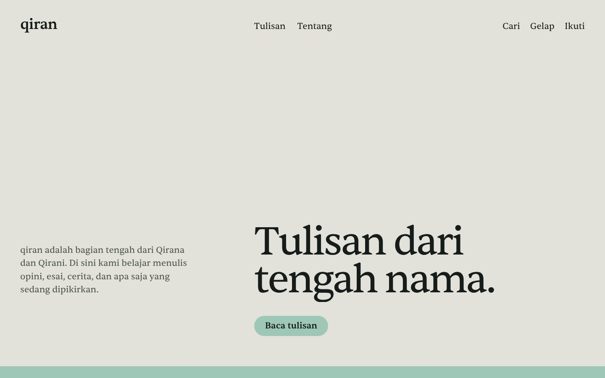
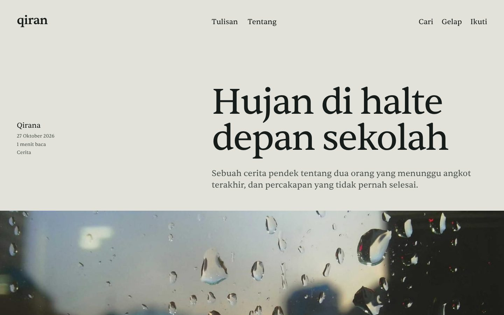

# qiran.my.id

**[qiran.my.id](https://qiran.my.id)** adalah blog tulisan Qirana dan Qirani, saudara kembar yang sedang belajar menulis.

Nama *qiran* diambil dari bagian tengah nama mereka: Qir**an**a dan Qir**an**i. Isinya opini, refleksi, cerita pendek, puisi, catatan pelajaran, dan review buku atau film. Tidak semua tulisan akan sempurna, karena blog ini memang tempat latihan.

## Isi blog

| Topik | Isinya |
| --- | --- |
| Opini | Pendapat tentang sekolah, kebiasaan, dan hal sehari-hari |
| Refleksi | Catatan tentang pengalaman dan apa yang dipelajari darinya |
| Cerita | Cerita pendek |
| Puisi | Puisi pendek |
| Belajar | Pelajaran sekolah yang dijelaskan ulang dengan cara sendiri |
| Review | Pendapat jujur tentang buku, film, dan lagu |

## Tampilan

Desainnya sengaja sederhana dan fokus ke tulisan: huruf besar, satu jenis huruf (Sentient), warna putih tulang dan hijau-hitam, dengan aksen hijau giok. Ada mode terang dan gelap, daftar tulisan yang bisa disaring per penulis, dan nama *qiran* yang tampil besar di bagian bawah setiap halaman.

## Dibangun dengan

- Aplikasi sendiri di folder [`web/`](web/): Next.js dan SQLite, dengan panel penulis dan editor visual
- aaPanel di VPS, Cloudflare untuk DNS dan SSL

Versi pertama memakai Ghost. Konfigurasi Ghost masih ada di repo ini sampai perpindahan selesai.

## Dokumen lain

- [Panduan menulis](PANDUAN-MENULIS.md): untuk Qirana dan Qirani, cara menulis dan menerbitkan tulisan
- [Pindah ke aplikasi sendiri](docs/PINDAH-KE-NEXTJS.md): pemasangan aplikasi Next.js di VPS dan perpindahan dari Ghost
- [Aplikasi web](web/README.md): fitur, struktur kode, dan perintah
- [Pemasangan Ghost](docs/PEMASANGAN.md): panduan versi Ghost (lama)
- [Catatan desain](theme/qiran/DESIGN.md): keputusan desain dan alasannya

## Lisensi

Kode dan tema berlisensi [MIT](LICENSE). Tulisan di blog adalah milik penulisnya masing-masing.
